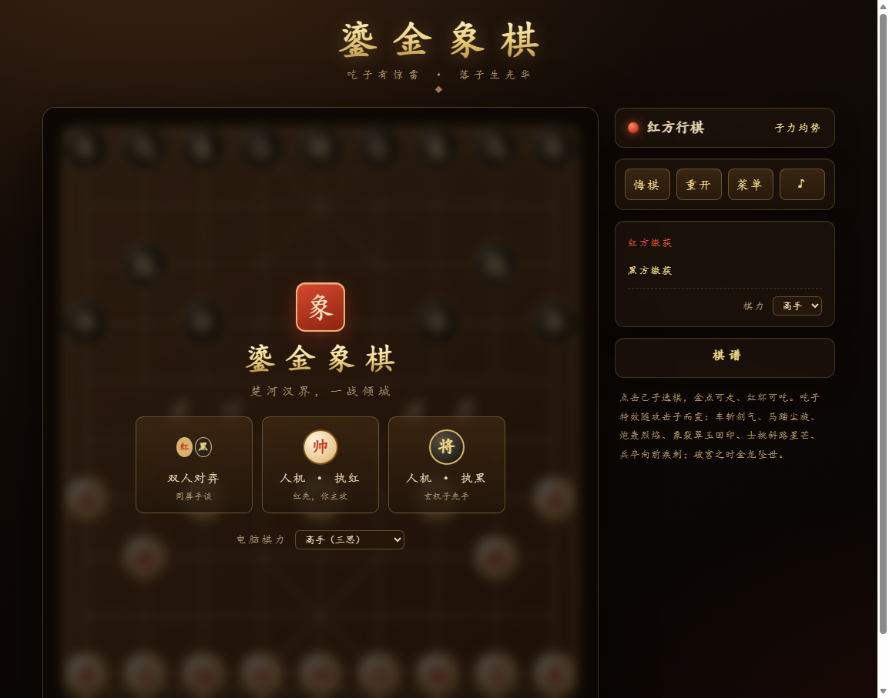

# 鎏金象棋

吃子有惊雷，落子生光华 —— 零依赖纯静态中国象棋，双击即玩。



## 玩法

- 双击 `index.html`（或运行 `start.bat`）即可在浏览器中开玩，无需安装、无需联网。
- 三种模式：**双人对弈**（同屏）、**人机执红**、**人机执黑**；三档棋力：新手 / 高手 / 大师。
- 点击己子选棋：金点为可走空位，红色旋转虚环为可吃敌子；再点目标点落子。
- 侧栏提供：回合提示、子力差、双方缴获、中文传统棋谱（炮二平五、马8进7……）、悔棋 / 重开 / 菜单 / 静音。

## 吃子特效

特效由**攻击子**主导（你用什么子吃，就放什么特效），被吃子保留为带重力的棋子碎片与汉字飞散；七型一眼可辨：

| 攻击子 | 视觉 | 浮字 | 合成音效 |
|--------|------|------|----------|
| **车** | 横向剑气火花 + 双月牙斩痕 | 斩 | 挥剑破空 + 剑鸣 |
| **马** | 切向尘金旋风 + 双旋臂 + 扬尘 | 踏 | 双蹄闷响 |
| **炮** | 全向烈焰爆 + 浓硝烟、大震屏 | 轰 | 低炮轰 + 碎裂 |
| **象** | 翠玉"田"字双印扩散 + 翠羽飘飞 | 裂 | 玉磬 + 玉碎 |
| **士** | 斜路八角星芒 + 碎菱金盾 | 挑 | 金铁交鸣 |
| **兵/卒** | 沿攻击方向的锥形疾刺光束 | 刺 | 短促破空 |
| **将/帅** | 小型王者光束（罕见） | 破 | 锣声 |

- 通用层：中心闪光、冲击波环、棋子碎片、被吃汉字飞散、浮字印招、震屏。
- **破宫之时（终局吃将）**：26 道光束、四环冲击波、升龙粒子、"绝杀"浮印、慢镜头定格与锣声（独立 `burstRoyal`，不与普通吃子混淆）。
- 音效全部由 WebAudio 实时合成，无任何音频素材。

## 规则

完整中国象棋规则：马蹩腿、象塞象眼且不过河、炮隔山打牛、士不离九宫、兵过河可横行、白脸将禁照面，以及将军 / 将死 / 困毙判定。

## 项目结构

```
xiangqi/
├── index.html        # 入口（菜单、棋盘、侧栏、浮层）
├── start.bat         # 双击用默认浏览器打开
├── css/style.css     # 檀木鎏金深色主题
├── js/
│   ├── rules.js      # 规则引擎（UMD，可独立 Node 引用）
│   ├── ai.js         # negamax + alpha-beta + 静止搜索（UMD）
│   ├── fx.js         # 粒子系统与合成音效（浏览器）
│   └── game.js       # 状态机、动画、Canvas 渲染、交互
└── tools/
    ├── test.js       # Node 打桩测试：规则 + AI（24 项）
    ├── cdp-smoke.js  # headless Edge CDP 真机冒烟
    └── shot-*.png    # 冒烟截图
```

## 测试

```bash
node tools/test.js        # 24 项规则/AI 断言
node tools/cdp-smoke.js   # 真机冒烟八场景（菜单/吃子特效双帧/悔棋/人机应着/重开竞态/执黑悔棋/三次重复和棋/七型特效签名，零 console 错误）
```

AI 说明：新手深度 1 带随机着法；高手深度 3；大师深度 4 并以 MVV-LVA 着法排序、PST 位置评估与吃子静止搜索（治水平效应）。**迭代加深 + 墙钟预算**（0.4 / 0.9 / 1.8 秒）：超时即采用上一完整深度的着法，大师首着约 14 万累计节点 / 1.4 秒。

另：三次重复局面自动判和（防长将/无限循环）。
